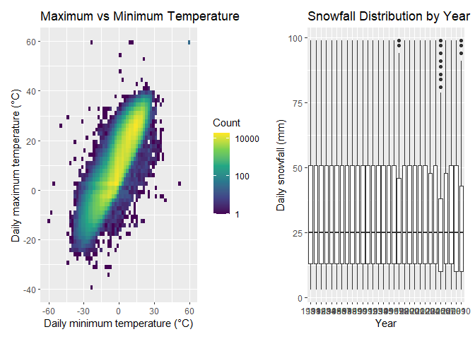
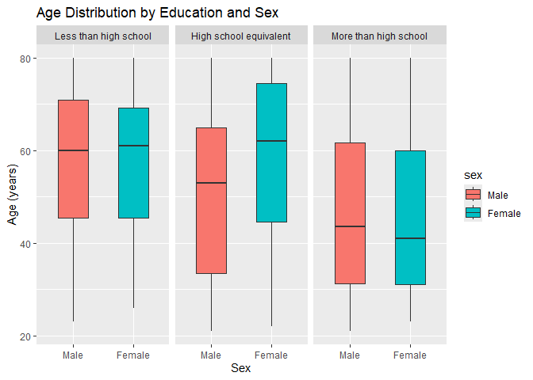
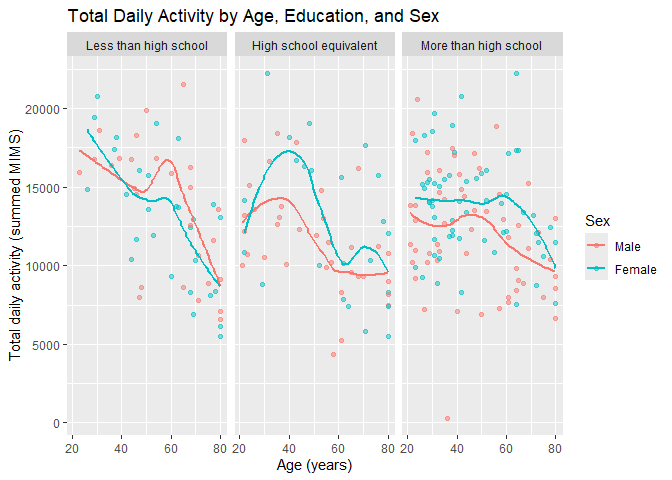

p8105_hw3_lm4199
================

``` r
library(tidyverse)
```

    ## ── Attaching core tidyverse packages ──────────────────────── tidyverse 2.0.0 ──
    ## ✔ dplyr     1.2.1     ✔ readr     2.2.0
    ## ✔ forcats   1.0.1     ✔ stringr   1.6.0
    ## ✔ ggplot2   4.0.3     ✔ tibble    3.3.1
    ## ✔ lubridate 1.9.5     ✔ tidyr     1.3.2
    ## ✔ purrr     1.2.2     
    ## ── Conflicts ────────────────────────────────────────── tidyverse_conflicts() ──
    ## ✖ dplyr::filter() masks stats::filter()
    ## ✖ dplyr::lag()    masks stats::lag()
    ## ℹ Use the conflicted package (<http://conflicted.r-lib.org/>) to force all conflicts to become errors

``` r
library(patchwork)
```

## Problem 1

``` r
library(p8105.datasets)

data("ny_noaa")
```

``` r
nrow(ny_noaa)
```

    ## [1] 2595176

``` r
ncol(ny_noaa)
```

    ## [1] 7

``` r
noaa_missing_df =
  ny_noaa |>
  summarise(
    across(
      everything(),
      ~ mean(is.na(.x))
    )
  ) |>
  pivot_longer(
    cols = everything(),
    names_to = "variable",
    values_to = "missing_proportion"
  ) |>
  mutate(
    missing_percent = round(missing_proportion * 100, 2)
  )

noaa_missing_df
```

    ## # A tibble: 7 × 3
    ##   variable missing_proportion missing_percent
    ##   <chr>                 <dbl>           <dbl>
    ## 1 id                   0                 0   
    ## 2 date                 0                 0   
    ## 3 prcp                 0.0562            5.62
    ## 4 snow                 0.147            14.7 
    ## 5 snwd                 0.228            22.8 
    ## 6 tmax                 0.437            43.7 
    ## 7 tmin                 0.437            43.7

The `ny_noaa` dataset contains 2595176 observations and 7 variables.
Each row represents a daily record from a weather station in New York
State. The variables include station ID, date, precipitation, snowfall,
snow depth, and maximum and minimum temperatures. Missing data are an
issue, especially for temperature: about 43.7% of values are missing for
both maximum and minimum temperatures. Precipitation, snowfall, and snow
depth have approximately 5.62%, 14.7%, and 22.8% missing values,
respectively. Station ID and date have no missing values. The
temperature variables are currently stored as character values and need
to be converted to numeric.

### Data clean

``` r
noaa_df =
  ny_noaa |>
  mutate(
    year = lubridate::year(date),
    month = lubridate::month(date),
    day = lubridate::day(date),
    tmax = as.numeric(tmax) / 10,
    tmin = as.numeric(tmin) / 10,
    prcp = prcp / 10
  )

snow_frequency_df =
  noaa_df |>
  filter(!is.na(snow)) |>
  count(snow, sort = TRUE)

head(snow_frequency_df, 10)
```

    ## # A tibble: 10 × 2
    ##     snow       n
    ##    <int>   <int>
    ##  1     0 2008508
    ##  2    25   31022
    ##  3    13   23095
    ##  4    51   18274
    ##  5    76   10173
    ##  6     8    9962
    ##  7     5    9748
    ##  8    38    9197
    ##  9     3    8790
    ## 10   102    6552

I created separate variables for year, month, and day. I converted the
temperature variables from character to numeric and changed their units
to degrees Celsius. I also converted precipitation to millimeters.
Snowfall and snow depth were already recorded in millimeters.

The most common snowfall value is 0 mm, with 2,008,508 observations.
This is expected because many station-day records have no snowfall. The
most common nonzero values are 25, 13, and 51 mm. These are close to 1,
0.5, and 2 inches, which suggests that unit conversion and rounding may
contribute to their high frequencies.

### Make a two-panel plot

``` r
noaa_monthly_df =
  noaa_df |>
  filter(month %in% c(1, 7), !is.na(tmax)) |>
  group_by(id, year, month) |>
  summarise(mean_tmax = mean(tmax), .groups = "drop") |>
  mutate(month = 
           factor(
             month,
             levels = c(1, 7),
             labels = c("January", "July")
    )
  )
```

``` r
noaa_monthly_df |>
  ggplot(aes(x = year, y = mean_tmax, group = id)) +
  geom_line(alpha = 0.2, linewidth = 0.3) +
  facet_wrap(~ month, nrow = 1) +
  labs(
    title = "Average Daily Maximum Temperature by Station",
    x = "Year",
    y = "Monthly mean daily maximum temperature (°C)"
  ) 
```

<!-- -->

July is much warmer than January. Temperatures vary across stations, but
many stations show similar changes from year to year. January also
appears to have larger year-to-year changes than July. There are a few
unusually low values, including a July value around 14°C in the late
1980s. These observations may reflect local conditions, limited daily
records, or data quality issues and would need further checking. A clear
long-term trend is not obvious from this plot.

### Make another two-panel plot

``` r
temperature_plot =
  noaa_df |>
  filter(!is.na(tmin), !is.na(tmax)) |>
  ggplot(aes(x = tmin, y = tmax)) +
  geom_bin_2d(bins = 60) +
  scale_fill_viridis_c(trans = "log10") +
  labs(
    title = "Maximum vs Minimum Temperature",
    x = "Daily minimum temperature (°C)",
    y = "Daily maximum temperature (°C)",
    fill = "Count"
  )

snowfall_plot =
  noaa_df |>
  filter(snow > 0, snow < 100) |>
  ggplot(aes(x = factor(year), y = snow)) +
  geom_boxplot() +
  labs(
    title = "Snowfall Distribution by Year",
    x = "Year",
    y = "Daily snowfall (mm)"
  )

temperature_plot + snowfall_plot
```

<!-- -->

I used a two-dimensional histogram because the dataset contains many
observations. Points would overlap heavily in a scatterplot. The fill
color shows the number of observations in each bin, making the
concentration of records easier to see.

Maximum and minimum temperatures show a strong positive relationship.
Most observations form a diagonal band, but a few extreme values are far
from the main pattern. Some records also appear to have minimum
temperatures higher than maximum temperatures. These observations would
need further checking.

For snowfall values greater than 0 and less than 100 mm, the
distributions are similar across most years. The median is around 25 mm
in most years, although some years, such as 2006, have a narrower
interquartile range. There is no clear long-term change in the
distributions shown. This plot describes snowfall amounts on the
selected days, rather than total annual snowfall.

## Problem 2

### Import, clean and merge

``` r
nhanes_covar_df =
  read_csv("data/nhanes_covar.csv", skip = 4, na = c("",".","NA")) |>
  janitor::clean_names() |>
  filter(age >= 21) |>
  drop_na(sex, age, bmi, education) |>
  mutate(
    sex = factor(sex, levels = c(1, 2), labels = c("Male", "Female")),
    education = factor(education, levels = c(1, 2, 3),
      labels = c(
        "Less than high school",
        "High school equivalent",
        "More than high school")
    )
  )
```

    ## Rows: 250 Columns: 5
    ## ── Column specification ────────────────────────────────────────────────────────
    ## Delimiter: ","
    ## dbl (5): SEQN, sex, age, BMI, education
    ## 
    ## ℹ Use `spec()` to retrieve the full column specification for this data.
    ## ℹ Specify the column types or set `show_col_types = FALSE` to quiet this message.

``` r
nhanes_accel_df =
  read_csv("data/nhanes_accel.csv", na = c("",".","NA")) |>
  janitor::clean_names()
```

    ## Rows: 250 Columns: 1441
    ## ── Column specification ────────────────────────────────────────────────────────
    ## Delimiter: ","
    ## dbl (1441): SEQN, min1, min2, min3, min4, min5, min6, min7, min8, min9, min1...
    ## 
    ## ℹ Use `spec()` to retrieve the full column specification for this data.
    ## ℹ Specify the column types or set `show_col_types = FALSE` to quiet this message.

``` r
nhanes_df =
  nhanes_covar_df |>
  inner_join(nhanes_accel_df, by = "seqn") |>
  pivot_longer(
    cols = min1:min1440,
    names_to = "minute",
    names_prefix = "min",
    values_to = "activity"
  ) |>
  mutate(minute = as.integer(minute))
```

### Make a table and a boxplot plot

``` r
nhanes_sex_table =
  nhanes_covar_df |>
  count(education, sex) |>
  pivot_wider(
    names_from = sex,
    values_from = n,
    values_fill = 0
  )

nhanes_sex_table |>
  knitr::kable(
    col.names = c("Education", "Male", "Female"),
    caption = "Number of participants by education and sex")
```

| Education              | Male | Female |
|:-----------------------|-----:|-------:|
| Less than high school  |   27 |     28 |
| High school equivalent |   35 |     23 |
| More than high school  |   56 |     59 |

Number of participants by education and sex

``` r
nhanes_covar_df |>
  ggplot(aes(x = sex, y = age, fill = sex)) +
  geom_boxplot(width = 0.5) +
  facet_wrap(~ education, nrow = 1) +
  labs(
    title = "Age Distribution by Education and Sex",
    x = "Sex",
    y = "Age (years)"
  ) 
```

<!-- -->

The more-than-high-school group has the most participants, with 56 men
and 59 women. The less-than-high-school group has similar numbers of men
and women, while the high-school-equivalent group has more men than
women.

For both sexes, the more-than-high-school group has a lower median age
than the other education groups. In the high-school-equivalent group,
women have a higher median age than men. Men and women have similar
median ages in the less-than-high-school group. The age distributions
overlap across all groups.

### Make a scatterplot

``` r
nhanes_total_df =
  nhanes_df |>
  group_by(seqn, sex, age, bmi, education) |>
  summarise(
    total_activity = sum(activity),
    .groups = "drop"
  )

nhanes_total_df |>
  ggplot(aes(x = age, y = total_activity, color = sex)) +
  geom_point(alpha = 0.5) +
  geom_smooth(method = "loess", se = FALSE) +
  facet_wrap(~ education, nrow = 1) +
  labs(
    title = "Total Daily Activity by Age, Education, and Sex",
    x = "Age (years)",
    y = "Total daily activity (summed MIMS)",
    color = "Sex"
  )
```

    ## `geom_smooth()` using formula = 'y ~ x'

<!-- -->

Total daily activity tends to be lower at older ages, although the
relationship is not linear. Women have higher smoothed activity levels
than men across much of the age range in the more-than-high-school
group. In the high-school-equivalent group, the female curve is higher
mainly around ages 30–50. Sex differences vary with age in the
less-than-high-school group. There is substantial variation between
participants of similar ages, so these curves describe overall patterns
rather than individual changes with aging.
