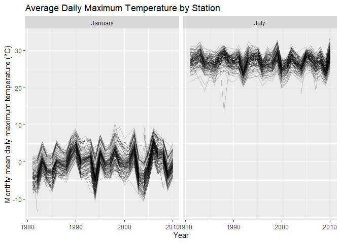

p8105_hw3_lm4199
================

``` r
library(tidyverse)
```

    ## ── Attaching core tidyverse packages ──────────────────────── tidyverse 2.0.0 ──
    ## ✔ dplyr     1.2.1     ✔ readr     2.2.0
    ## ✔ forcats   1.0.1     ✔ stringr   1.6.0
    ## ✔ ggplot2   4.0.3     ✔ tibble    3.3.1
    ## ✔ lubridate 1.9.5     ✔ tidyr     1.3.2
    ## ✔ purrr     1.2.2     
    ## ── Conflicts ────────────────────────────────────────── tidyverse_conflicts() ──
    ## ✖ dplyr::filter() masks stats::filter()
    ## ✖ dplyr::lag()    masks stats::lag()
    ## ℹ Use the conflicted package (<http://conflicted.r-lib.org/>) to force all conflicts to become errors

## Problem 1

``` r
library(p8105.datasets)

data("ny_noaa")
```

``` r
nrow(ny_noaa)
```

    ## [1] 2595176

``` r
ncol(ny_noaa)
```

    ## [1] 7

``` r
noaa_missing_df =
  ny_noaa |>
  summarise(
    across(
      everything(),
      ~ mean(is.na(.x))
    )
  ) |>
  pivot_longer(
    cols = everything(),
    names_to = "variable",
    values_to = "missing_proportion"
  ) |>
  mutate(
    missing_percent = round(missing_proportion * 100, 2)
  )

noaa_missing_df
```

    ## # A tibble: 7 × 3
    ##   variable missing_proportion missing_percent
    ##   <chr>                 <dbl>           <dbl>
    ## 1 id                   0                 0   
    ## 2 date                 0                 0   
    ## 3 prcp                 0.0562            5.62
    ## 4 snow                 0.147            14.7 
    ## 5 snwd                 0.228            22.8 
    ## 6 tmax                 0.437            43.7 
    ## 7 tmin                 0.437            43.7

The `ny_noaa` dataset contains 2595176 observations and 7 variables.
Each row represents a daily record from a weather station in New York
State. The variables include station ID, date, precipitation, snowfall,
snow depth, and maximum and minimum temperatures. Missing data are an
issue, especially for temperature: about 43.7% of values are missing for
both maximum and minimum temperatures. Precipitation, snowfall, and snow
depth have approximately 5.62%, 14.7%, and 22.8% missing values,
respectively. Station ID and date have no missing values. The
temperature variables are currently stored as character values and need
to be converted to numeric.

### Data clean

``` r
noaa_df =
  ny_noaa |>
  mutate(
    year = lubridate::year(date),
    month = lubridate::month(date),
    day = lubridate::day(date),
    tmax = as.numeric(tmax) / 10,
    tmin = as.numeric(tmin) / 10,
    prcp = prcp / 10
  )

snow_frequency_df =
  noaa_df |>
  filter(!is.na(snow)) |>
  count(snow, sort = TRUE)

head(snow_frequency_df, 10)
```

    ## # A tibble: 10 × 2
    ##     snow       n
    ##    <int>   <int>
    ##  1     0 2008508
    ##  2    25   31022
    ##  3    13   23095
    ##  4    51   18274
    ##  5    76   10173
    ##  6     8    9962
    ##  7     5    9748
    ##  8    38    9197
    ##  9     3    8790
    ## 10   102    6552

I created separate variables for year, month, and day. I converted the
temperature variables from character to numeric and changed their units
to degrees Celsius. I also converted precipitation to millimeters.
Snowfall and snow depth were already recorded in millimeters.

The most common snowfall value is 0 mm, with 2,008,508 observations.
This is expected because many station-day records have no snowfall. The
most common nonzero values are 25, 13, and 51 mm. These are close to 1,
0.5, and 2 inches, which suggests that unit conversion and rounding may
contribute to their high frequencies.

### Make a two-panel plot

``` r
noaa_monthly_df =
  noaa_df |>
  filter(month %in% c(1, 7), !is.na(tmax)) |>
  group_by(id, year, month) |>
  summarise(mean_tmax = mean(tmax), .groups = "drop") |>
  mutate(month = 
           factor(
             month,
             levels = c(1, 7),
             labels = c("January", "July")
    )
  )
```

``` r
noaa_monthly_df |>
  ggplot(aes(x = year, y = mean_tmax, group = id)) +
  geom_line(alpha = 0.2, linewidth = 0.3) +
  facet_wrap(~ month, nrow = 1) +
  labs(
    title = "Average Daily Maximum Temperature by Station",
    x = "Year",
    y = "Monthly mean daily maximum temperature (°C)"
  ) 
```

<!-- -->

July is much warmer than January. Temperatures vary across stations, but
many stations show similar changes from year to year. January also
appears to have larger year-to-year changes than July. There are a few
unusually low values, including a July value around 14°C in the late
1980s. These observations may reflect local conditions, limited daily
records, or data quality issues and would need further checking. A clear
long-term trend is not obvious from this plot.

### 
